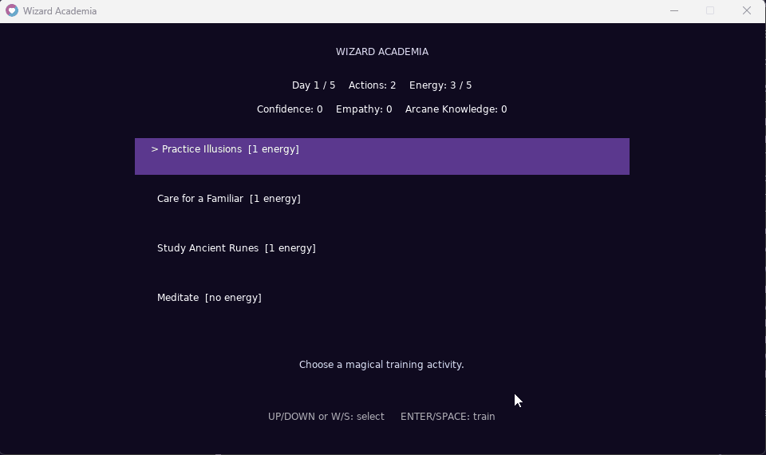
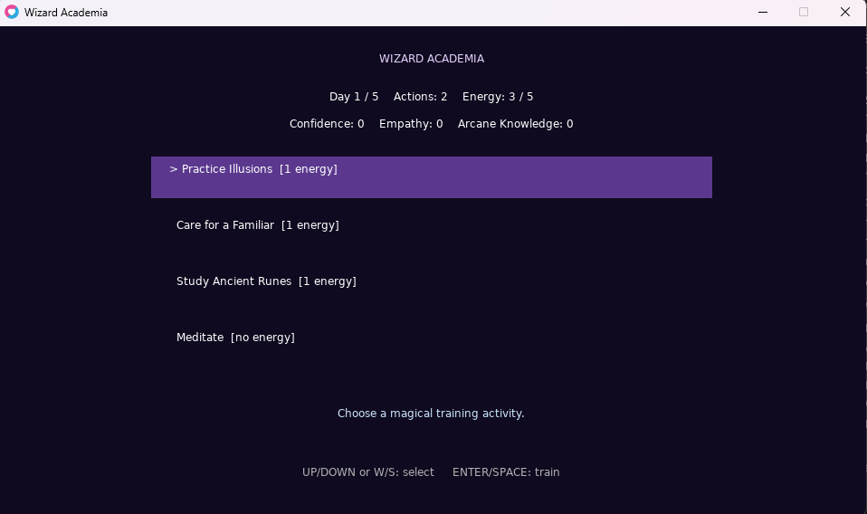
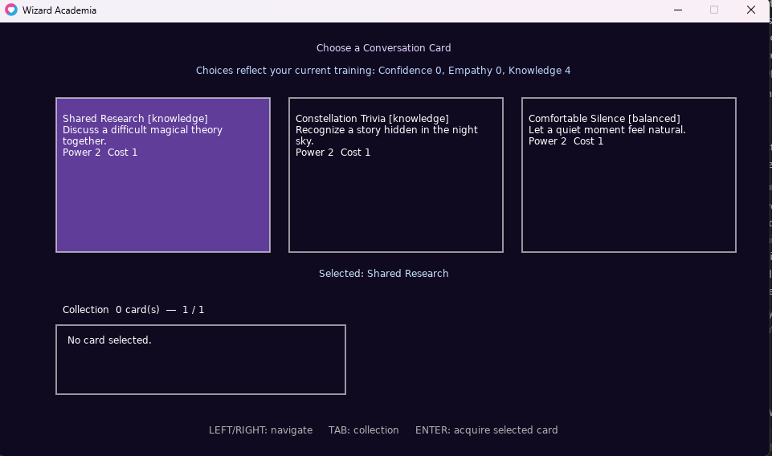

# Wizard Academia evidencia de portafolio

## Flujo
Correr `love .` desde la raiz del repo. El juego comienza con la escena de entrenamiento.
Luego de completar dos acciones de entrenamiento, se elige una carta de conversación, se presiona Enter
nuevamente para iniciar un nuevo día. El proceso termina en el día 5. 

## Enlaces de implementación

1. Shared run data: [GameSession.lua](src/game/session/GameSession.lua)
Se encarga de crear las sesiones y manejarlas por medio de la capa de aplicación y no por medio 
del ECS. De esta forma está desligada y posee su propia responsabilidad.

2. Training Scene: [TrainingScene.lua](src/game/scenes/TrainingScene.lua)
Crea una escena de entrenamiento con base en una sesión válida. Si la sesión no es válida
no procede.

3. Training logic: [Systems.lua](src/game/progression/Systems.lua)
Se usa para tener un módulo que registra distintos sistemas que se encarga
de instalarlos al orquestrador de escenas. Este se enfoca inicialmente en la lógica de 
la escena de entrenamiento, donde maneja el input, las actividades, feedback y las transiciones. 

4. Deterministic card generation: [CardGenerationSystem.lua](src/game/cards/CardGenerationSystem.lua)
Se crea una creación de cartas determinística para las diferentes cartas que logren aparecer en el juego. 
De momento el generador no emplea uso de semillas o de contenido pseudo-aleatorio para la generación y elige la 
primera de cada categoría (12 en total que van en categorías de _confidence_, _empathy_, _knowledge_ y _balanced_,
como se ve en el [CardCatalog](src/game/cards/CardCatalog.lua)). 

5. Card Acquisition Scene: [CardAcquisitionScene.lua](src/game/scenes/CardAcquisitionScene.lua)
En esta escena se permite seleccionar 1 de  3 cartas desplegadas. Este se encarga, por medio de 
[CardAcquisitionSystem.lua](src/game/cards/CardAcquisitionSystem.lua) de agrear una carta más a la colección.

6. Daily transition and completion: [DayAdvanceSystem.lua](src/game/cards/DayAdvanceSystem.lua)
Este sistema nos permite cambiar de día.

7. End-to-end test: [arcane_daily_cycle_test.lua](tests/arcane_daily_cycle_test.lua)
Tests para asegurar el correcto funcionamiento de las funciones y valores esperados.

## Demo
Pequeño video de demostración del juego que dura 5 días y donde uno puede elegir y cambiar de la escena de entrenamiento
hacia la escena de adquisición de cartas. Dependiendo de los niveles de energía ciertas actividades se puede hacer; si 
no hay suficiente energía para una actividad, toca meditar. Las cartas son añadidas mientras las vamos recolectando y podemos
observar las que hay usando TAB y luego las flechas de los lados. 

## Escenas
Aquí se muestra imágenes de las escenas contenidas dentro del juego.

### Escena inicial: el entrenamiento. 
En esta escena, la principal al iniciar el juego, se da 4 opciones al jugador. 
Estas son _practice illusions_, _care for a familiar_, _study ancient runes_, _meditate_. De las cuales solo la opción
de meditar no require de energía alguna. Las otras requiren al menos 1 de energía; el día comienza teniendo 3/5 de energía
y 2 acciones. 

### Escena secundaria: adquisición de cartas.
En esta otra escena se nos otorga la posibilidad de adquirir cartas. Se presenta 3 cartas en pantalla para que nosotros elijamos
cuál tomar. También en la esquina inferior izquierda se nos muestra las cartas que tenemos hasta el momento. 

### Escena final: fin
En esta última escena se culmina los 5 días de entrenamiento y termina el ciclo.

