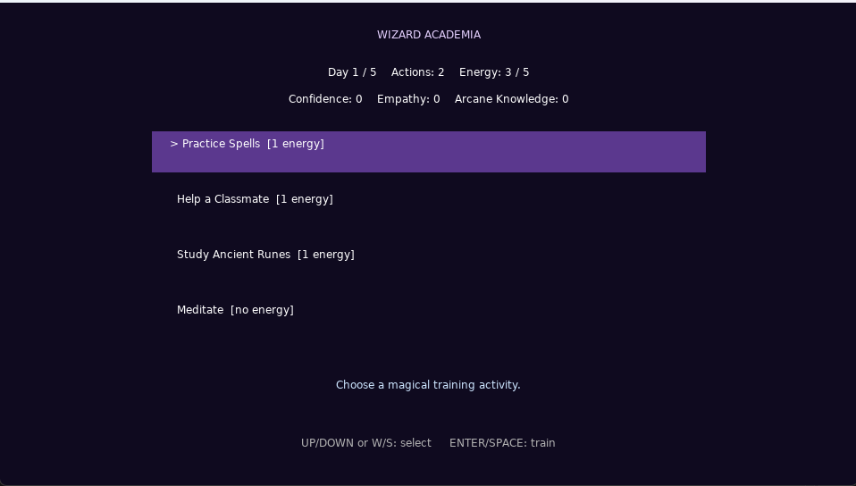
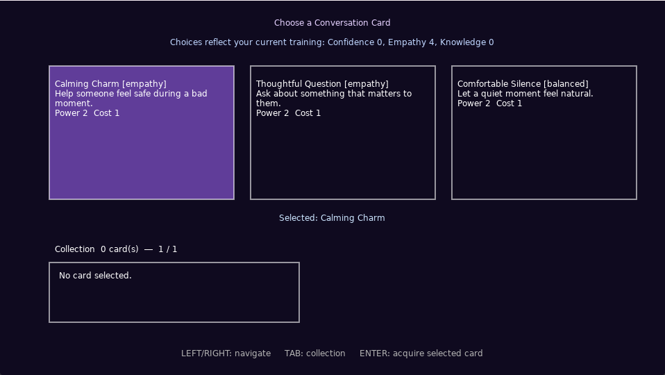
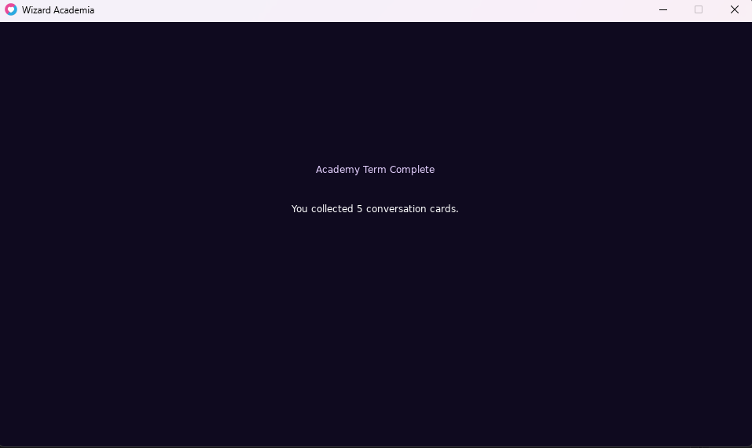
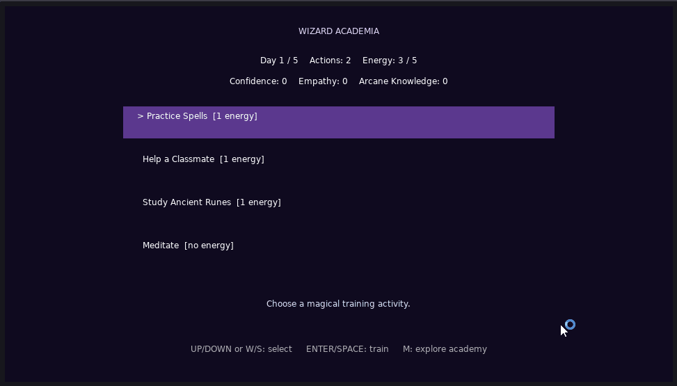
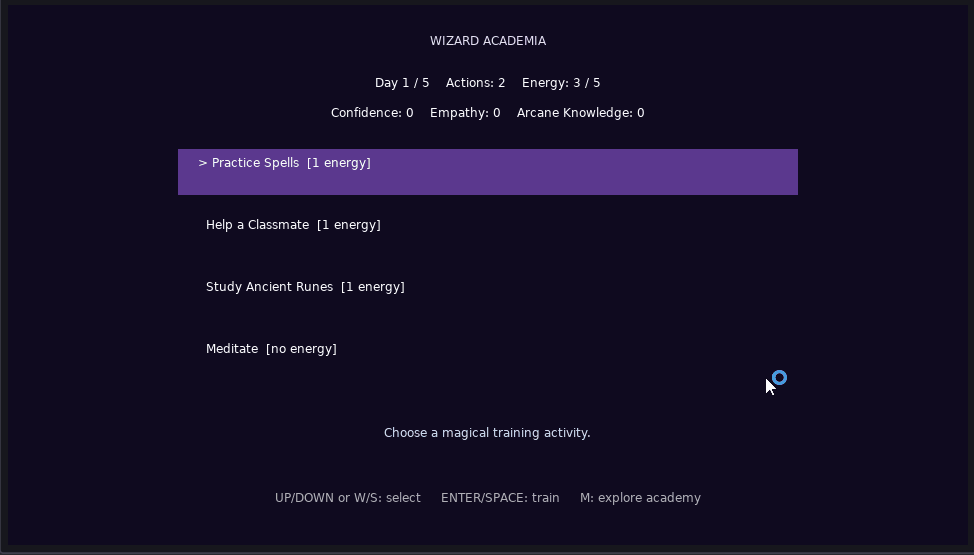
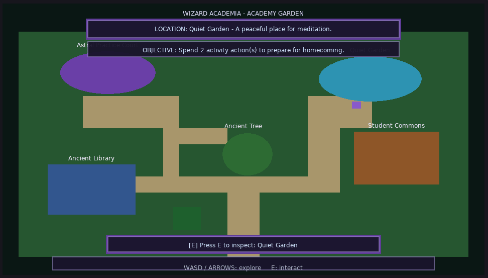

# Wizard Academia evidencia de portafolio

## Progression Cycle
Correr `love .` desde la raiz del repo. El juego comienza con la escena de entrenamiento.
Luego de completar dos acciones de entrenamiento, se elige una carta de conversación, se presiona Enter
nuevamente para iniciar un nuevo día. El proceso termina en el día 5. 

El ciclo del juego es:
1. Inicia un nuevo día
2. Se elige dos actividades de entrenamiento
3. Se cambia los estados, energía y el feedback
4. Se recibe tres opciones de cartas para elegir basadas en el entrenamiento
5. Se elige una carta para almacenar en la colección
6. Comienza un nuevo día
7. Se repite hasta completar el quinto día

## Enlaces de implementación Progression Cycle

1. Shared run data: [GameSession.lua](src/game/session/GameSession.lua)
Se encarga de crear las sesiones y manejarlas por medio de la capa de aplicación y no por medio 
del ECS. De esta forma está desligada y posee su propia responsabilidad.

2. Training Scene: [TrainingScene.lua](src/game/scenes/TrainingScene.lua)
Crea una escena de entrenamiento con base en una sesión válida. Si la sesión no es válida
no procede.

3. Training logic: [TrainingActivitySystem.lua](src/game/progression/TrainingActivitySystem.lua)
Se usa para tener un módulo que registra distintos sistemas que se encarga
de instalarlos al orquestrador de escenas. Este se enfoca inicialmente en la lógica de 
la escena de entrenamiento, donde maneja el input, las actividades, feedback y las transiciones. 

4. Deterministic card generation: [CardGenerationSystem.lua](src/game/cards/CardGenerationSystem.lua)
Se crea una creación de cartas determinística para las diferentes cartas que logren aparecer en el juego. 
De momento el generador no emplea uso de semillas o de contenido pseudo-aleatorio para la generación y elige la 
primera de cada categoría (12 en total que van en categorías de _confidence_, _empathy_, _knowledge_ y _balanced_,
como se ve en el [CardCatalog](src/game/cards/CardCatalog.lua)). 

5. Card Acquisition Scene: [CardAcquisitionScene.lua](src/game/scenes/CardAcquisitionScene.lua)
En esta escena se permite seleccionar 1 de  3 cartas desplegadas. Este se encarga, por medio de 
[CardAcquisitionSystem.lua](src/game/cards/CardAcquisitionSystem.lua) de agrear una carta más a la colección.

6. Daily transition and completion: [DayAdvanceSystem.lua](src/game/cards/DayAdvanceSystem.lua)
Este sistema nos permite cambiar de día hasta que se cumple el máximo de días permitidos por la sesión. 

7. End-to-end test: [arcane_daily_cycle_test.lua](tests/arcane_daily_cycle_test.lua)
Tests para asegurar el correcto funcionamiento de las funciones y valores esperados.

## Demo Progression Cycle
Pequeño video de demostración del juego que dura 5 días y donde uno puede elegir y cambiar de la escena de entrenamiento
hacia la escena de adquisición de cartas. Dependiendo de los niveles de energía ciertas actividades se puede hacer; si 
no hay suficiente energía para una actividad, toca meditar. Las cartas son añadidas mientras las vamos recolectando y podemos
observar las que hay usando TAB y luego las flechas de los lados. 

## Escenas
Aquí se muestra imágenes de las escenas contenidas dentro del juego.

### Escena inicial: el entrenamiento. 
En esta escena, la principal al iniciar el juego, se da 4 opciones al jugador. 
Estas son _practice illusions_, _care for a familiar_, _study ancient runes_, _meditate_. De las cuales solo la opción
de meditar no require de energía alguna. Las otras requiren al menos 1 de energía; el día comienza teniendo 3/5 de energía
y 2 acciones. 

### Escena secundaria: adquisición de cartas.
En esta otra escena se nos otorga la posibilidad de adquirir cartas. Se presenta 3 cartas en pantalla para que nosotros elijamos
cuál tomar. También en la esquina inferior izquierda se nos muestra las cartas que tenemos hasta el momento. 

### Escena final: fin
En esta última escena se culmina los 5 días de entrenamiento y termina el ciclo.

## Map Scene
En esto se muestra el mapa del juego. Este está compuesto por un jardín que está compuesto por
_Ancient Library_, que es donde se puede estudiar las runas y obtener conocimiento, _Student Commons_, 
donde se puede aumentar la empatía, _Astral Practice Court_, donde se practica hechizos y confianza y
_Quiet Garden_ que es donde se medita. El mapa tiene un árbol central que sirve como punto de referencia
y obstáculo.

## Enlaces implementación Maps

### Setup
Para el setup del mapa se tiene [AcademyMapScene](src/game/scenes/AcademyMapScene.lua) que se encarga de 
crear la escena del mapa. [MapSetupSystem](src/game/maps/MapSetupSystem.lua) se encarga de crear
al jugador, la escenografía y los datos de representación. Además de los límites y el grid del terreno. 

### Update
Para el update se usa [MapInputSystem](src/game/maps/MapInputSystem.lua) que se encarga de leer
las teclas WASD o flechas. [PlayerMovementSystem](src/game/maps/PlayerMovementSystem.lua) que calcula
el movimiento delta time. [MapCollisionSystem](src/game/maps/MapCollisionSystem.lua) se encarga de 
delimitar el mapa y de crear obstáculos. [PointOfInterestSystem](src/game/maps/PointOfInterestSystem.lua)
se encarga de detectar sitios de interés cercanos, como puede ser la librería o el jardín.

### Render
Para el render se separa el world, los objetos, etiquetas y HUD render. Lo que es visible
es el jugador, mapa, objetos en el relieve, etiquetas de los sitios, controles y el panel de proximidad.

### Movimiento y colisión
Para el movimiento se puede usar las teclas WASD o flechas, cualesquiera funciona para comodidad del jugador. El movimiento se basa en el delta time y el movimiento diagonal se normaliza para hacerlo más sutil y suave, además que se 
usa que cada movimiento maneje un eje por separado para así permitir que el jugador pueda deslizarse a lo largo
de un obstáculo sin quedar atorado. También se usa las colisiones para evitar que el jugador deje el área circundante del mapa, no pueda atravesar sitios u obstáculos. 

### Puntos de interés
Cuando un jugador se acerca a un punto de interés, puede ser el _Ancient Library_, el sistema de puntos de interés
lo detecta y por medio de este se despliega su nombre. 

### Integración de escenas
El bucle comienza con la escena de entrenamiento, presionar la tecla M lleva al jardín de la academia y con 
la tecla BACKSPACE se regresa a la escena de entrenamiento. Al retornar se preserva la sesión del juego
por lo que la exploración del mapa no interfiere con el progreso del jugar ni lo reinicia.

