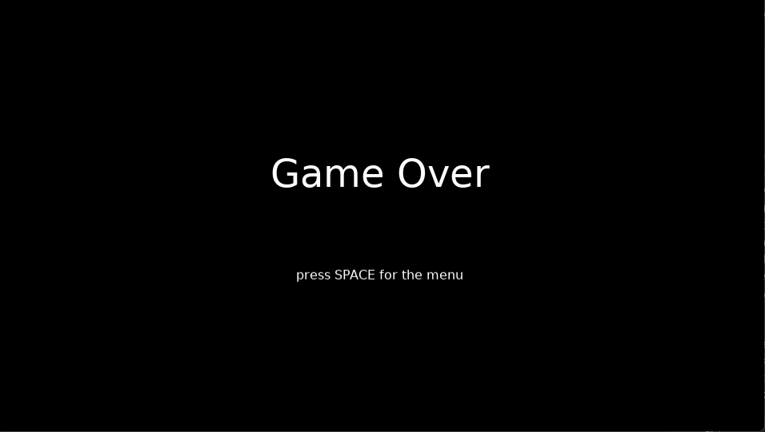

# ECS Breakout

A small Breakout game written in Lua for LOVE 11.5. It is also a learning and
experimentation project for a custom, reusable Entity Component System (ECS).

The active game path uses the custom `World`, `Scheduler`, `Runtime`, Scene,
and SceneManager layers. 



## Gameplay specification

- One paddle moves horizontally with `Left`/`Right` or `A`/`D`.
- The paddle is clamped to the logical game screen.
- A rectangular ball moves using delta-time-based velocity.
- The ball bounces from the left, right, and top screen edges.
- The ball bounces from a descending collision with the paddle; hit position
  adjusts its horizontal velocity.
- The board contains 50 rectangular bricks in a 5 × 10 grid.
- One brick is removed per ball collision per fixed simulation tick.
- Missing the ball ends the round with `Game Over`.
- Removing every brick ends the round with `You win!`.
- Starting play again creates a fresh World, match resource, paddle, ball, and
  full brick layout.

## Requirements

- [LOVE 11.5](https://love2d.org/) to run the game.
- Lua 5.1, LuaJIT, or another compatible Lua runtime to run the headless tests.
- Windows, macOS, or Linux.

No external Lua package is required for normal gameplay.

## Run the game

From the repository root:

```sh
love .
```

On Windows PowerShell, when LOVE is not on `PATH`:

```powershell
& "C:\Program Files\LOVE\love.exe" .
```

For a console window with LOVE runtime errors:

```powershell
& "C:\Program Files\LOVE\love.exe" --console .
```

## Controls

| Action | Keys |
| --- | --- |
| Start or return to the menu | `Space` |
| Move left | `Left Arrow` or `A` |
| Move right | `Right Arrow` or `D` |
| Quit | `Escape` |

## Scene flow

```text
Menu --Space--> Play
Play --ball lost--> Game Over (Game Over)
Play --all bricks removed--> Game Over (You win!)
Game Over --Space--> Menu
```

Scene transitions are requested through ECS event channels and applied by
SceneManager after the active Runtime stage completes. This prevents a scene or
World from being disposed while one of its systems is still executing.

## Timing

The active LOVE entry point uses a fixed physics step:

```text
Physics frequency: 120 Hz
Physics step:      1 / 120 second
Maximum frame dt:  0.25 second
Logical screen:    960 × 540
```

The reusable `LoveRunner` also supports an ECS SceneManager with a separate
variable render frequency, input queue, transient time resource, pause, time
scale, and interpolation alpha.

## Architecture

```text
main.lua                     LOVE callbacks and fixed-step entry point
src/engine/ecs/              reusable ECS core
src/engine/loop/             fixed-step and LOVE runner adapters
src/engine/scene/            Scene and deferred SceneManager
src/game/ecs/                Breakout components, resources, events, systems
src/game/scenes/             ECS-backed menu, play, and game-over factories
src/game/Game.lua            application facade and input queue
src/game/Screen.lua          logical 960 × 540 game resolution
src/debug/                   optional debug overlay integration
src/engine/legacy/           obsolete compatibility implementation; pending removal
src/game/systems/            obsolete legacy systems; pending removal
```

The separation is intentional:

- `src/engine/ecs/` defines how the ECS works: generational entities,
  components, queries, commands, resources, events, scheduling, runtime,
  snapshots, relationships, and diagnostics.
- `src/game/ecs/` defines how Breakout uses that ECS: paddle/ball/brick data,
  match and input resources, scene events, gameplay systems, and rendering.

Core ECS modules do not import LOVE or Breakout code.

## ECS and game contracts

### Engine services

- Generational entity handles prevent stale entity IDs from being reused.
- Component stores use sparse-set-style storage and validated definitions.
- Queries support required, optional, excluded, any, changed, and stable views.
- Structural changes use deferred commands during system execution.
- Resources are world-level singleton values; input and render assets are
  transient.
- Events are double-buffered and validated at their channel boundary.
- Scheduler ordering is explicit through stages and `before`/`after` metadata.
- Render stages execute with a read-only World.
- Snapshots, prefab instantiation, hierarchy, diagnostics, and invariant
  validation are available through the ECS public API.

### Breakout execution order

```text
inputState
→ paddleControl
→ movement
→ horizontalClamp
→ ballWallBounce
→ paddleHits
→ brickCollision
→ ballLoss
→ winCheck
```

The game owns `match`, `input`, and `screen` resources. Terminal gameplay emits
`roundWon` or `roundLost`, then a `sceneRequest` event for the game-over scene.

## Tests

Run the complete headless suite from the repository root:

```powershell
& "C:\Program Files (x86)\Lua\5.1\lua.exe" tests\run.lua
```

The suite currently contains ECS unit tests plus Breakout integration coverage
for scene flow, fresh Worlds, win/loss transitions, input events, collision
behavior, pause/draw behavior, and equivalent simulation outcomes at 30, 60,
and 144 rendered FPS.

For the remaining interactive checks, see
[PHASE13_MANUAL_CHECKLIST.md](PHASE13_MANUAL_CHECKLIST.md). Its entries are
pending until they are observed manually in LOVE.

## Debug overlay

The optional editor-style overlay is intended to launch with:

```powershell
& "C:\Program Files\LOVE\love.exe" . --debug
```

It supports entity inspection, scene switching, system enablement, pause, and
single-frame stepping. The repository currently does **not** include its
required vendored `lib/imlove.lua` dependency or font asset, so this mode will
not launch until those assets are restored or the overlay is replaced with a
dependency-free implementation.

## Current migration status

The custom ECS and ECS-backed Breakout scene path are covered by automated
tests. Before deleting `src/engine/legacy` and `src/game/systems`, complete the
manual LOVE checklist and record the results. Phase 14 release tagging must
wait until that migration gate has passed.

## AI assistance disclosure

This repository has used AI-assisted development tools, including OpenAI Codex,
for planning, code generation, refactoring, test creation, documentation, and
review support. AI-produced changes should be treated like any other proposed
change: reviewed, tested, and validated by a human maintainer before release.

The project owner remains responsible for the architecture, final decisions,
manual gameplay verification, dependency licensing, and all distributed code.
