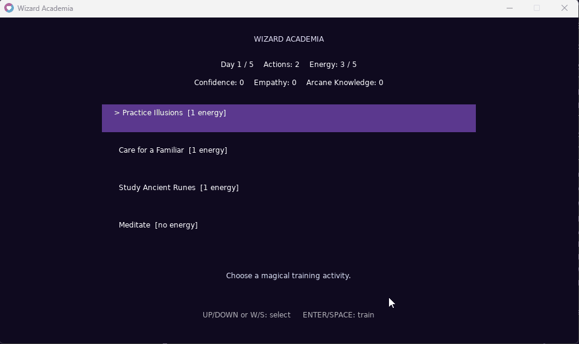

# Wizard Academia

Wizard Academia is a small keyboard-driven fantasy dating-sim progression loop
written in Lua for LOVE 11.5. It uses this repository's custom ECS, scheduler,
runtime, and scene manager rather than an external ECS library.

The game is intentionally scoped to the assignment's progression cycle:

```text
Train at the academy
    → improve attributes and manage energy
    → receive three conversation cards influenced by training
    → acquire one card for a persistent collection
    → begin the next day
    → use collected cards in a final conversation after day five
```

After five academy days, the player uses three collected cards in a final
conversation before reaching a completion screen whose ending reflects final
rapport.

The Academy Garden is the normal starting hub. Its locations are the physical
activity and conversation loop; exploration itself does not consume an action.
The Training Scene remains a separate development-facing presentation of the
same activity rules.

The four Academy Garden points of interest open reusable location scenes:
Astral Practice Court, Student Commons, Ancient Library, and Quiet Garden.
Activities and scheduled NPC conversations occur inside those rooms; travel
itself never consumes an action.



## Requirements

- [LOVE 11.5](https://love2d.org/) to play.
- Lua 5.1, LuaJIT, or a compatible Lua runtime for headless tests.

No external Lua package is required for normal gameplay.

## Run

From the repository root:

```sh
love .
```

On Windows PowerShell, when LOVE is not on `PATH`:

```powershell
& "C:\Program Files\LOVE\love.exe" .
```

## Controls

| Scene | Action | Keys |
| --- | --- | --- |
| Training | Select an activity | `Up`/`Down` or `W`/`S` |
| Training | Perform selected activity | `Enter` or `Space` |
| Training | Explore the Academy Garden | `M` |
| Academy Garden | Move | `W`/`A`/`S`/`D` or arrow keys |
| Academy Garden | Enter a nearby location | `E` |
| Academy Garden | Return to Training (only when entered from Training) | `Backspace` |
| Academy Location | Move inside the fixed-camera room | `W`/`A`/`S`/`D` or arrow keys |
| Academy Location | Start a nearby activity, speak, or exit | `E` / `Enter` / `Space` |
| Spell Rehearsal | Confirm while the marker is inside the green focus zone | `E` / `Enter` / `Space` |
| Rune Study challenge | Trace the displayed rune sequence | arrow keys |
| Choice activity challenge | Change/confirm the selected response | arrows, then `E` / `Enter` / `Space` |
| Academy Location | Return to the Academy Garden | `Backspace` |
| Daily room conversation | Select/play a collected card | arrows, then `E` / `Enter` / `Space` |
| Card Acquisition | Change selected generated card or collection card | `Left`/`Right` or `A`/`D` |
| Card Acquisition | Switch generated-card / collection focus | `Tab` |
| Card Acquisition | Acquire selected card; after acquisition, start the next day | `Enter` or `Space` |
| Final Conversation | Select a collected card | `Left`/`Right` or `A`/`D` |
| Final Conversation | Play selected card | `Enter` or `Space` |
| Any scene | Quit | `Escape` |

Training has two actions each day:

| Activity | Cost | Effect |
| --- | --- | --- |
| Practice Spells | 1 energy | Confidence +2 |
| Help a Classmate | 1 energy | Empathy +2 |
| Study Ancient Runes | 1 energy | Arcane Knowledge +2 |
| Meditate | 1 action | Energy +2, capped at the maximum |

## Card generation

There are twelve conversation cards: three in each of `confidence`, `empathy`,
`knowledge`, and `balanced` categories. Each acquisition scene deterministically
generates three unique choices:

1. The strongest attribute's category; ties choose `balanced`.
2. The category associated with the last training activity.
3. A `balanced` card.

This makes the effect of player decisions visible both in the session stats and
in the card choices.

## Activity challenges

Room activities begin with a small interaction challenge before their normal
cost and effect resolve. Spell Rehearsal uses a delta-time moving marker and a
focus zone; Study Ancient Runes uses a deterministic three-arrow sequence.
Help a Classmate and Meditate present a short response choice. A failed timing
or rune attempt simply restarts; a completed challenge delegates to the
existing activity rules, so Energy, stats, card generation, and scene
transitions remain unchanged.

## Architecture

```text
src/engine/ecs/                 reusable custom ECS core
src/engine/scene/               ECS Scene and deferred SceneManager
src/game/session/GameSession.lua persistent plain-data run state
src/game/progression/           training definitions and systems
src/game/cards/                 generation, acquisition, navigation, day flow
src/game/encounters/            final conversation definitions and systems
src/game/maps/                  Academy Garden map contracts and systems
src/game/locations/             reusable room contracts and location systems
src/game/scenes/                Training, Card Acquisition, completion factories
src/game/ui/                    read-only LOVE render systems, including the map
tests/                          ECS and Wizard Academia headless tests
```

The shared `GameSession` exists above individual scene Worlds. Each scene owns
its own ECS World, but receives the same validated plain-data session object so
stats, generated cards, and the collection persist across transitions.


For submission screenshots/GIF guidance and direct source links, see
[PORTFOLIO_EVIDENCE.md](PORTFOLIO_EVIDENCE.md).

## Tests

Run the complete suite from the repository root:

```powershell
& "C:\Program Files (x86)\Lua\5.1\lua.exe" tests\run.lua
```

The Wizard Academia coverage includes session isolation, validated events,
training success/rejection feedback, deterministic card generation, collection
persistence, map movement/collision/POI transitions, location contracts,
activity/dialogue behavior, safe map returns, optional-art fallbacks, and a
complete five-day route through dedicated location scenes to the final ending.

## AI assistance disclosure

This repository has used AI-assisted development tools, including OpenAI Codex,
for planning, code generation, refactoring, testing, documentation, and review.
All generated changes should be reviewed and manually verified by the project
owner before submission or release.

### Wizard Academia progression-cycle disclosure

The Wizard Academia progression cycle—including the session contract, training
and card systems, scene wiring, automated tests, and supporting repository
documentation—was implemented with AI assistance. The project owner is
responsible for reviewing the code, validating gameplay in LOVE, and writing
their own portfolio explanation of the design and implementation.

## Repository information and documentation index

This repository contains a reusable custom ECS engine and the Wizard Academia
game layer built on it. Wizard Academia is the active LOVE entry point.

| Documentation | Contents |
| --- | --- |
| [README.md](README.md) | Wizard Academia setup, controls, game loop, card rule, tests, and disclosure. |
| [src/engine/README.md](src/engine/README.md) | Reusable ECS, scheduler, runtime, scenes, timing, snapshots, and diagnostics. |
| [src/game/README.md](src/game/README.md) | Boundaries between reusable engine code and replaceable game code. |
| [src/game/progression/README.md](src/game/progression/README.md) | Existing generic progression-cycle package and its contracts. |
| [src/game/cards/README.md](src/game/cards/README.md) | Wizard Academia card-data boundary and plain-data rule. |
| [src/game/ui/README.md](src/game/ui/README.md) | UI-system ownership rules. |
| [planning_files/ui_planning.md](planning_files/ui_planning.md) | Phased requirements and exit criteria for the three Wizard Academia UI systems. |
| [src/game/maps/README.md](src/game/maps/README.md) | Academy Garden map contracts, movement, collision, POIs, and transitions. |
| [planning_files/gameplay_implementation_beta.md](planning_files/gameplay_implementation_beta.md) | Dedicated location-scene architecture, phased implementation, and acceptance criteria. |
| [planning_files/map_implementation.md](planning_files/map_implementation.md) | Academy Garden map layout, ECS flow, systems, transitions, rendering, and verification. |
| [tests/README.md](tests/README.md) | Headless test-runner conventions. |
| [PORTFOLIO_EVIDENCE.md](PORTFOLIO_EVIDENCE.md) | Source links and the visual-evidence checklist. |
| [assets/demo/wizard-academia/README.md](assets/demo/wizard-academia/README.md) | Required screenshot and GIF/video filenames and capture targets. |
